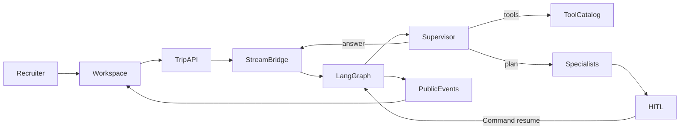
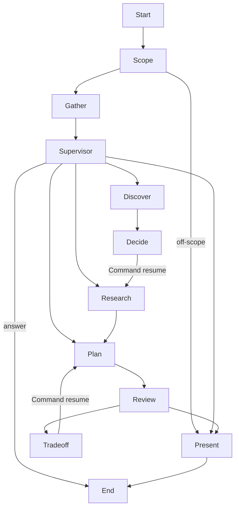
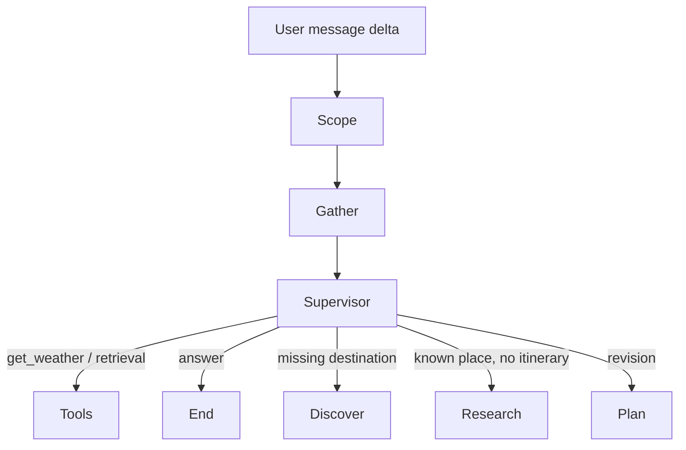

# Route State

A public, no-signup travel planner used as an AI engineering showcase. The product is a trip. The argument is that **LangGraph owns durable orchestration** while the UI only consumes an allowlisted public event stream.

Open `/`, start **Warm family beach in Europe**, choose a destination, and watch the same interrupted thread resume into an itinerary. After a plan exists, ask `what is the weather like in there?` The supervisor answers with tools instead of re-presenting the folio. For a second interrupt, start **City break, food and culture, under 1500 EUR**, pick a place, then choose whether to protect the budget or the packed pace.

This is a hiring demo, not authoritative travel advice. The default runtime is deterministic so CI and the public site stay alive. Set `ROUTE_STATE_RUNTIME=live` with `OPENAI_API_KEY` or `AI_GATEWAY_API_KEY` to call models, stream tokens, query pgvector, and fetch Open-Meteo weather.

Built by Denes Papp.

## Recruiter path

1. Open `/`
2. Start the family-beach starter and inspect a graph node
3. Ask a freeform question after the plan, or start the city-break starter for the tradeoff interrupt
4. Optional: `/case-study` and `/replay/family-beach-europe`

## Architecture

LangGraph owns state, routing, interrupts, and checkpoints. The Next.js trip API sends only the new user delta. The AI SDK / NDJSON bridge streams public events and assistant tokens. Clients never append a transcript to the checkpointer.



`src/ai/graph/spec.ts` is the shared registry for the compiled graph, the Orchestration Atlas, the LangFlow viewer artifact, and replay fixtures. Node IDs do not drift.

### Request path

| Layer | Owns | Code |
|---|---|---|
| Workspace | Atlas, chat, folio, process path | `src/features/workspace` |
| Trip API | Create, run, resume, images | `app/api/trips` |
| Stream bridge | NDJSON frames, optional live tokens | `src/ai/stream/bridge.ts` |
| Public events | Allowlisted graph / trip / evidence / usage | `src/ai/stream/public-events.ts` |
| Compiled graph | Routing, interrupts, checkpoints | `src/ai/graph/compile.ts` |
| Supervisor | ReAct answer or specialist route | `src/ai/graph/supervise.ts` |
| Tools | Node-scoped allowlist | `src/ai/tools/catalog.ts` |
| Retrieval | Catalog titles, pgvector when live | `src/ai/retrieval/hybrid.ts` |
| Persistence | Owner-bound anonymous trips | Supabase + RLS |

## Compiled graph

Every user turn starts at Scope. Gather extracts facts. The supervisor then either **answers and ends** or **routes into a specialist**. Destination choice and the pace-versus-budget tradeoff are first-class interrupt nodes. Resume uses `Command({ resume })`.



| Node | Id | Role |
|---|---|---|
| Scope | `scope_guard` | Block off-scope and injection before tools run |
| Gather | `gather_preferences` | Fill useful `TripState` fields and session memory |
| Supervisor | `route_supervisor` | ReAct turn: tools, then `answer` / `discover` / `research` / `plan` / `present` |
| Discover | `discover_destinations` | Rank catalog places with RAG and weather |
| Decide | `await_destination_choice` | HITL destination interrupt |
| Research | `research_local` | Neighborhoods, pace, and local evidence |
| Plan | `plan_itinerary` | Structured day-by-day itinerary |
| Review | `critique_itinerary` | Pace, geography, and budget conflicts |
| Tradeoff | `await_tradeoff` | Optional HITL when two viable plans conflict |
| Present | `present_plan` | Public itinerary. Folio shows when `lastTurnKind` is `plan` |

### Freeform turn

After a plan exists, a weather or day question does not re-run Present. The supervisor reads the latest delta, resolves “there” from trip state, calls tools, and ends the turn. If planning is unfinished, it answers first and steers toward the next missing field or specialist.



## Tools

Tools are authorized per node. A call that is not on `NODE_TOOL_ALLOWLIST` throws.

| Tool | What it returns | Typical nodes |
|---|---|---|
| `read_trip_state` | Public destination and stage fields | Gather, Supervisor, Review |
| `search_memories` / `write_memory` | Session-scoped travel preferences | Gather, Supervisor |
| `lookup_destination_profile` | Catalog traits for a slug | Supervisor, Discover, Research |
| `search_travel_knowledge` | Evidence titles from the corpus or pgvector | Supervisor, Discover, Research, Plan |
| `get_weather` | Open-Meteo when live, catalog fallback otherwise | Supervisor, Discover, Research |
| `convert_currency` | Static fallback rates | Supervisor, Discover, Plan |

Retrieved chunk bodies stay on the server. Public `evidence` events carry titles, ids, and source types only. Weather fails closed: 4s timeout, then the catalog sketch.

## Public stream

The client sees NDJSON frames with `{ text }`, `{ event }`, or `{ done: true }`. Event types:

`graph` · `trip-state` · `interrupt` · `evidence` · `usage` · `error`

Prompts, secrets, checkpoint blobs, and retrieved chunk bodies never stream. Model tier and estimated cents can appear on `usage`. The header labels **Fake**, **Live**, or **Recorded**.

## Runtime

| Mode | When | Behavior |
|---|---|---|
| Fake | Default, Vitest, Playwright | Deterministic graph, catalog weather, no model calls |
| Live | `ROUTE_STATE_RUNTIME=live` plus a key | Supervisor tool loop, token stream, pgvector, Open-Meteo |
| Recorded | Budget exhausted, `REPLAY_ONLY`, or `/replay/...` | Golden fixtures for the 90-second path |

Atomic spend reservation (`DAILY_BUDGET_CENTS`) keeps the public demo from dying mid-recruiter session. Live models stay optional: `configurable.liveModels` on the graph, forced off under `VITEST=true` or `PLAYWRIGHT=1`.

## Stack

| Area | Choice |
|---|---|
| App | Next.js 16 App Router, React 19, TypeScript, Tailwind v4 |
| Agent | LangGraph.js, LangChain.js, Vercel AI SDK |
| Atlas | React Flow (`@xyflow/react`) |
| Data | Supabase (RLS, anonymous sessions), `pg` pooler for live RAG |
| Retrieval | Checked-in travel corpus, pgvector when live |
| Weather | Open-Meteo |
| Abuse / spend | Vercel BotID, daily budget, replay fallback |
| Tests | Vitest, Playwright |

## Repo map

```
src/ai/graph          spec, state, ranking, supervisor, compiled graph
src/ai/stream         public event protocol and NDJSON bridge
src/ai/runtime        run, replay, budget
src/ai/tools          allowlist, weather, catalog adapters
src/ai/retrieval      hybrid search
src/features/workspace  Orchestration Atlas and conversation
app/api/trips         create, snapshot, run, images
data/travel           synthetic catalog
langflow/             non-runtime viewer artifact
docs/                 architecture, security, evaluation, runbook
```

## Setup

```sh
pnpm install
cp .env.example .env.local
pnpm dev
```

```sh
pnpm test
pnpm typecheck
pnpm lint
pnpm test:e2e
pnpm generate:corpus
pnpm seed:corpus
```

Live models, pgvector, and Open-Meteo:

```sh
# .env.local
ROUTE_STATE_RUNTIME=live
OPENAI_API_KEY=...
# or AI_GATEWAY_API_KEY=...
SUPABASE_SESSION_POOLER_DATABASE_URL=...
```

## Docs

- [`docs/architecture.md`](docs/architecture.md) interview map
- [`docs/security.md`](docs/security.md) RLS, BotID, public-event rules
- [`docs/evaluation.md`](docs/evaluation.md) what CI proves
- [`docs/runbook.md`](docs/runbook.md) flags, live setup, rollback
- `/case-study` in the running app: short hiring argument
