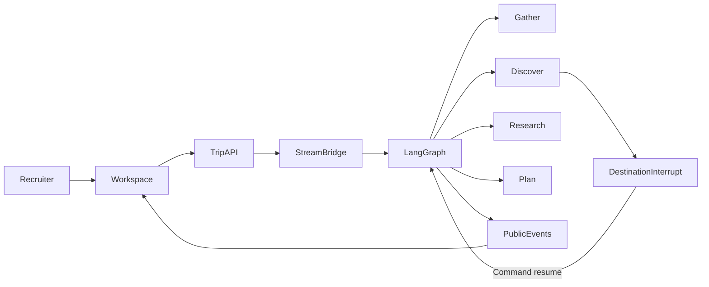

# Architecture

LangGraph owns durable state, routing, interrupts, and checkpoints.
The AI SDK / NDJSON bridge owns the recruiter-facing stream.
`src/ai/graph/spec.ts` is the shared registry for the compiled graph, atlas, LangFlow artifact, and replay fixtures.

Interview map:

| Question | Code |
|---|---|
| How do you keep HITL on the same thread? | `src/ai/graph/compile.ts` `await_destination_choice` / `await_tradeoff` + `Command` |
| How do you stop clients from stuffing history? | `app/api/trips/[id]/run/route.ts` sends only the new delta |
| How do you expose a graph without leaking prompts? | `src/ai/stream/public-events.ts` |
| How do you keep the demo alive? | `src/ai/runtime/budget.ts` + `src/ai/replay` |
| How do you authorize tools? | `src/ai/tools/catalog.ts` `NODE_TOOL_ALLOWLIST` |
| How do you revise a finished plan? | `src/ai/graph/revisions.ts` on the same thread |
| How do freeform turns stay on the graph? | `src/ai/graph/supervise.ts` ReAct supervisor answers or routes; `lastTurnKind` gates the folio |
| How do live models stay optional? | `src/lib/env.ts` `isLiveModelsEnabled` + graph `configurable.liveModels` |
| How do you stream tokens without leaking prompts? | `src/ai/stream/bridge.ts` `createAssistantStream` over the same NDJSON contract |
| How does retrieval stay public-safe? | `src/ai/retrieval/hybrid.ts` returns titles only; chunk bodies never stream |
| How does weather fail closed? | `src/ai/tools/weather.ts` Open-Meteo with a 4s timeout and catalog fallback |
